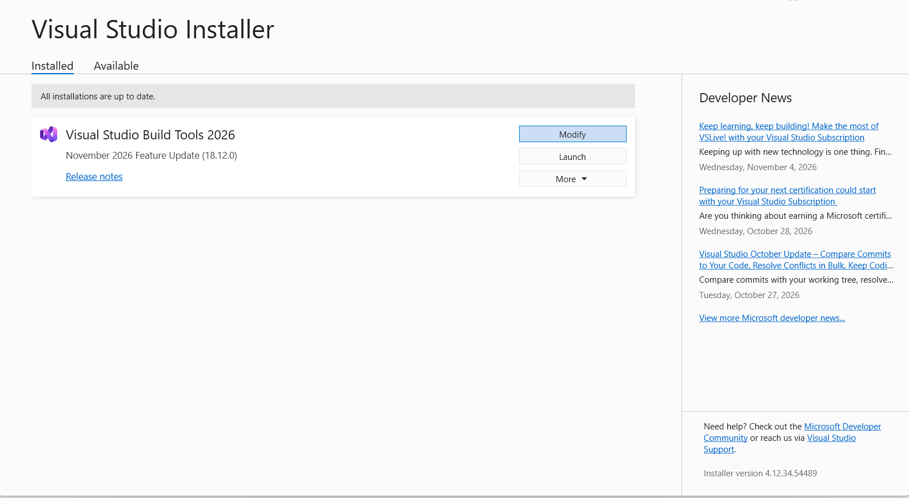
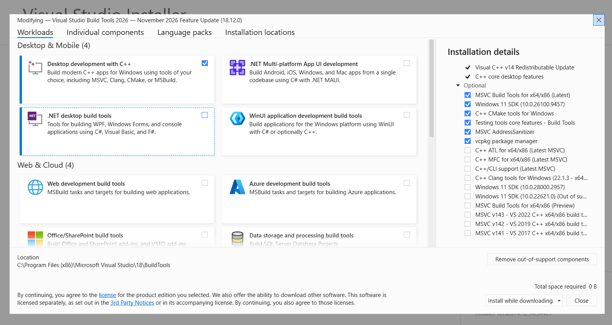

# Sand Simulation (sand-sim)
An implementation of a sandbox cellular automata.

In the sandbox, a tile particle interacts with the tiles immediately surrounding it, depending on what element the tile is.

Sand falls, water flows, steam rises, wood burns, fire extinguishes!

Written in C23 using [SDL3](https://www.libsdl.org/).

Personal learner project by Daniel Galvan.


This project is to be continuously expanded with additional customization options and compile targets.

## Usage
### Prerequisites

#### Linux
- Contents of `sand-sim` directory as downloaded from the "releases" tab.
- [SDL3](https://github.com/libsdl-org/SDL)
- [SDL3_image](https://github.com/libsdl-org/SDL_image)

#### Windows
- Contents of `sand-sim-mingw` or `sand-sim-msvc` directory as downloaded from the "releases" tab.
- (For MSVC version only) [Microsoft Visual C++ v14 Redistributable (x64)](https://learn.microsoft.com/en-us/cpp/windows/latest-supported-vc-redist?view=msvc-170)

On Windows, sand-sim has two versions: `sand-sim-mingw` and `sand-sim-msvc`. `sand-sim-mingw` is recommended for being the more portable of the two.

Alternatively, [WSL](https://learn.microsoft.com/en-us/windows/wsl/install) can be used if running on Windows to use the Linux version.

### Installation

sand-sim must be executed with its `assets` directory in the same location as the executable.

SDL3 is required for sand-sim to run.

#### Windows

To have SDL3 installed for use by sand-sim, the provided `SDL3.dll` and `SDL3_image.dll` must be
present in the same directory as `sand-sim.exe`. Inside both `sand-sim-mingw` and `sand-sim-msvc`,
this structure is already setup correctly.

For the MSVC port of sand-sim only, [Microsoft Visual C++ v14 Redistributable (x64)](https://learn.microsoft.com/en-us/cpp/windows/latest-supported-vc-redist?view=msvc-170) must be installed. Download the x64 installer on the Microsoft webpage and follow the onscreen instructions.

sand-sim can then be run using the provided `sand-sim.exe` binary. 

> [!IMPORTANT]
> Windows Defender may pop up with a [warning message](https://superuser.com/questions/1553842/windows-protected-your-pc) regarding `sand-sim.exe` being an unrecognized app. Clicking "More info" and then "Run anyway" will enable the app to run. (sand-sim is not malicious, the source code can checked to verify this) 


#### Linux
On Debian-based Linux distributions, SDL3 can be installed system-wide. 

To do this, run the following:

```bash
sudo apt install libsdl3-0
```

SDL3_image is also required, which can be installed similarly:

```bash
sudo apt install libsdl3-image0
```

Once SDL3 is installed, sand-sim can be run using the provided binary:

```bash
./sand-sim
```

### Controls

Use the left mouse button the generate tile particles into the sandbox!

Use the right mouse button to switch the tile placement mode:
- Pencil - Place tiles, new tiles to be placed highlighted by a square 'ghost'.
- Eraser - Delete tiles, tiles to be removed highlighted by a red grid.
- Brush - Replace tiles hovered over with currently selected tile type.

The selected tile type may be changed using the keyboard or the mouse scroll
wheel. Below is the key to type mapping:

- 1 - Sand
- 2 - Water
- 3 - Wood
- 4 - Steam
- 5 - Fire
- 6 - Fuel

Holding L-CTRL enables changing brush size when scrolling the mouse wheel.

The panel in the topleft represents your currently selected element.

Press ESC to quit the app.


### Command-Line Arguments

The size of the sandbox simulation can be customized at the command-line with
a simple command-line interface:

```bash
Usage: ./sand-sim [options]
Options:
  -h/--help      This message.
  --size         Size preset of sandbox, either "small", "medium", or "large".
  --width        Set tile width of the sandbox. Overrides --size. If specified, height must be specified too.
  --height       Set tile height of the sandbox. Overrides --size. If specified, width must be specified too.
```

Any custom widths/heights greater than 0 passed to sand-sim will be bound by the width and height of the "small" and "large" size sandboxes.

For example, on Linux, to set the sandbox to be a size of 50 x 80 would look like the following:

```bash
./sand-sim --width 50 --height 80
```

Similarly on Windows:

```bash
.\sand-sim.exe --width 50 --height 80
```

As another example, to use the "large" setting sandbox on Linux:

```bash
./sand-sim --size large
```

And on Windows:
```bash
.\sand-sim.exe --size large
```

If no command-line arguments are passed, sand-sim defaults to a 'medium' size
sandbox.

If any command-line arguments are invalid for any reason, sand-sim will repeat
its usage string.


## Building From Source

After cloning the project repository, the provided Makefiles present at the project root 
can be used to compile sand-sim once the required dependencies are in place.

### Compiling on Linux

> [!NOTE]
> The compilation instructions below assume a Debian-based Linux enviroment. 

Compiling sand-sim's Linux version requires the development versions of 
SDL3 and SDL3_image, which can be installed on Debian-based systems with the commands:

```bash
sudo apt install libsdl3-dev
sudo apt install libsdl3-image-dev
```

Compilation on Linux requires clang and pkg-config, which can be installed with the commands:

```bash
sudo apt install pkg-config
sudo apt install clang
```

Once the above is installed, sand-sim can be built from the project root directory using Make and the provided Makefiles. To build the Linux version, call Make:

```bash
make
```

This will produce a binary called `sand-sim` which can be executed to run the program.

It is instead possible to cross-compile the Windows versions of sand-sim on Linux.
To do this, the 64-bit Win32 implementation of [MinGW64](https://www.mingw-w64.org/getting-started/debian/) is required:

```bash
# Alternatively, the more general `apt install mingw-w64` also works but will install many other mingw components not required by sand-sim. 
sudo apt install gcc-mingw-w64-x86-64-win32
```

sand-sim can then be built for Windows on Linux from the project root directory with the command:

```bash
make sand-sim.exe
```

The necessary SDL3 Windows pre-compiled MinGW binaries are provided with the source of
sand-sim and no external installation of SDL3 is necessary for compiling the Windows version.

On WSL, the above output binary can be run natively. On Linux, the Windows cross-compile of sand-sim can also be run correctly using [Wine](https://www.winehq.org/)!

First install Wine:
```bash
sudo apt install wine wine64
```
Then the Windows cross-compile can be run on Linux like so:
```bash
wine ./sand-sim.exe
```

### Compiling on Windows

Compiling sand-sim on Windows requires the Microsoft C runtime from Visual Studio Build Tools 2026, the LLVM toolchain, and Git Bash.

Git Bash is likely already installed, assuming `git` was used to clone sand-sim, as the two come together on Git for Windows. 
If `git` is not installed, it can be installed using [winget](https://learn.microsoft.com/en-us/windows/package-manager/winget/), the official Windows package manager, like so:

```bash
winget install --id=Git.Git -e
```

The LLVM toolchain can be installed similarly:
```bash
winget install --id=LLVM.LLVM -e
```

Finally, the installer for Build Tools: 

```bash
winget install --id=Microsoft.VisualStudio.BuildTools -e
```

Alternatively, the Visual Studio Installer for Build Tools can be downloaded [from
Microsoft's webpage](https://visualstudio.microsoft.com/downloads/?q=build+tools)

Follow the link above and scroll down to "Tools for Visual Studio" under "All Downloads". Download
and run `vs_BuildTools.exe` from the downloadable "Build Tools for Visual Studio 2026". 

Once installed (using either method above), open the Visual Studio Installer and click `Modify` on 'Visual Studio Build Tools 2026':



Inside Build Tools workloads, enable "Desktop development with C++".



Click "Modify" on the bottom right of the installer and allow the Visual Studio Installer to install MSVC and the Microsoft C runtime environment.

After Build Tools has finished, it is recommended to restart the machine to ensure all the installed dependencies can be correctly recognized in PATH. 

Once finished, sand-sim's Windows version can be built from the project root directory.

First enter a build environment by running the `enter_bash.bat` auxiliary script:

```bash
.\enter_bash.bat
```

This script will open a Developer-enabled Git Bash command prompt which allows the MSVC C runtime and clang from LLVM to be available in PATH.

sand-sim can then be built into a binary `sand-sim.exe` by calling Microsoft NMAKE:

```bash
# (Inside Git Bash)
nmake
./sand-sim.exe
```

The build command will generate the necessary pre-compiled MSVC builds of the SDL3 DLLs next to `sand-sim.exe` to
allow the binary to run, so no separate install of SDL3 is necessary.

No additional installation of the Microsoft Visual C++ v14 Redistributable is necessary, since the Microsoft C runtime comes bundled with the "Desktop development with C++" workload.

The opened Git Bash command prompt can additionally be used to clean up the project directory of compiler artifacts:
```bash
nmake clean
```


## Development Environment Setup

Building sand-sim is entirely CLI-based, so any popular C/C++ IDE or text editor can be used. 

VSCode and CLion are recommended for their native integration with [clangd](https://clangd.llvm.org/) as a C language server.

clangd requires a `compile_commands.json` to provided proper language server analysis. Having a compilation database present at the project root allows CLion or VSCode with an installed [clangd VSCode extension](https://marketplace.visualstudio.com/items?itemName=llvm-vs-code-extensions.vscode-clangd) to recognize sand-sim's dependencies and provide
in-editor hints and documentation.

With a created `compile_commands.json`, the [Clang Static Analyzer](https://clang-analyzer.llvm.org/) can be also used via clang-tidy to analyze the sand-sim source against the defined checks in the provided `.clang-tidy` at project root. This `.clang-tidy` file defines several checks that lint the sand-sim codebase for error-prone C code, while also providing reasonable exceptions for idiomatic C.

The instructions that follow assume the necessary steps have first been taken to build sand-sim.

### Developing on Linux

To generate `compile_commands.json`, either use [Bear](https://github.com/rizsotto/Bear) or [compiledb](https://github.com/nickdiego/compiledb). This document recommends compiledb, as it is the more cross-platform of the two.

compiledb requires Python 3.3 or higher. Any Debian-based distribution should have Python already installed out-of-the-box, however the ability to make Python virtual environments may not necessarily be available.

To [avoid breaking Debian](https://wiki.debian.org/DontBreakDebian) (and Debian-based systems), do not install Python packages system-wide via `pip`. Prefer to use a virtual environment instead to isolate the compiledb dependency

Install python-venv if not already available:

```bash
sudo apt install python3-venv
```

Then create a virtual environment and install compiledb:

```bash
python3 -m venv .venv
source .venv/bin/activate
pip install compiledb
```

compiledb can then be used to generate a compilation database from sand-sim's compile command:
```bash
make clean
compiledb make
```

Alternatively, using Bear, Bear can be installed as below:
```bash
sudo apt install bear
```

Then Bear can be used to generate a compilation database from sand-sim's compile command:
```bash
make clean
bear -- make
```

clang-tidy can then be run to provide detailed analysis on potentially problematic code. 

First install clang-tidy:

```bash
sudo apt install clang-tidy
```

Then run clang-tidy static analysis against the source code using `compile_commands.json` like so:

```bash
run-clang-tidy
```

The clang-tidy conventions used by sand-sim follow those specified by the [RHEL docs](https://developers.redhat.com/blog/2021/04/06/get-started-with-clang-tidy-in-red-hat-enterprise-linux#using_clang_tidy_in_red_hat_enterprise_linux) and the [official LLVM docs](https://clang.llvm.org/extra/clang-tidy/).

A debug compile of sand-sim is also available, enabled to run with [AddressSanitizer](https://releases.llvm.org/20.1.0/tools/clang/docs/AddressSanitizer.html).

The debug sand-sim compile additionally disables optimization and generates DWARF symbols for use with LLDB.
In order to use ASAN, the LLVM toolchain must be installed:

```bash
# Enable usage of `llvm-symbolizer` in PATH.
sudo apt install llvm
```

sand-sim can then be compiled for debugging like so:

```bash
make debug
```

And run with combined AddressSanitizer  + LeakSanitizer stack tracing like so:
```bash
ASAN_OPTIONS=fast_unwind_on_malloc=false ./sand-sim
```

### Developing on Windows

> [!TIP]
> If using an IDE instead of a simple text editor, you will likely want to start it from within the sand-sim project root inside a developer-enabled Git Bash from `enter_bash.bat`. This way clang, LLDB, ASAN, and the MSVC C runtime are available in PATH to the IDE.

To generate `compile_commands.json`, use [compiledb](https://github.com/nickdiego/compiledb). 

compiledb requires Python 3.3 or higher. Install Python 3.14 using the Windows package manager:

```bash
winget install Python.Python.3.14
```

A virtual environment should be created to contain the compiledb install. First open the developer-enabled Git Bash via `enter_bash.bat`, then inside the Git Bash developer command prompt:

```bash
# Explicitly use Python 3.14 to create this venv.
py -3.14 -m venv .venv
source .venv\Scripts\Activate
python -m pip install --upgrade pip
```

compiledb can then be installed:
```bash
pip install compiledb
```

From inside Git Bash, as opened by `enter_bash.bat`, compiledb can then be used to generate a compilation database by feeding it sand-sim's compile command:
```bash
nmake clean
nmake | compiledb
```

clang-tidy can further be run inside Git Bash to provide detailed analysis on potentially problematic code. 

Assuming the instructions to build sand-sim on Windows were followed, then clang-tidy should already be installed from the LLVM toolchain and be available inside `enter_bash.bat`.

Unlike Linux, Windows will install Python as `python`, which is not compatible with clang-tidy's `run-clang-tidy` script, where `python3` is required.

There are several ways to get around this, but the simplest is to create a copy of the `python.exe` binary inside the created virtual environment called `python3.exe` while in Git Bash:

```bash
# Make sure you're in Git Bash to enable use of GNU Coreutils
cp .venv/Scripts/python.exe .venv/Scripts/python3.exe
```

Then, from inside `enter_bash.bat`, run clang-tidy static analysis against the source code via the `compile_commands.json` produced from compiledb like so:

```bash
# You must enter the Python 3.14 venv inside Git Bash if not already inside it.
run-clang-tidy
```

The above command may fail in Git Bash with an error `/usr/bin/env: ‘python3’: No such file or directory` or `Python was not found` if `python3.exe` is not available in the Python virtual environment as previously instructed above.

The clang-tidy conventions used by sand-sim follow those specified by the [RHEL docs](https://developers.redhat.com/blog/2021/04/06/get-started-with-clang-tidy-in-red-hat-enterprise-linux#using_clang_tidy_in_red_hat_enterprise_linux) and the [official LLVM docs](https://clang.llvm.org/extra/clang-tidy/).

A debug compile of sand-sim is also available, enabled to run with [AddressSanitizer](https://releases.llvm.org/20.1.0/tools/clang/docs/AddressSanitizer.html).

The debug sand-sim compile additionally disables optimization and generates DWARF symbols for use with LLDB.

To produce the debug build of sand-sim, first enter a developer-enabled Git Bash terminal:

```bash
.\enter_bash.bat
```

Then from inside Git Bash, call NMAKE with the `debug` target:

```bash
nmake debug
```

The debug build of `sand-sim.exe` can then be run from within LLDB. 

AddressSanitizer from the official LLVM Windows distribution may sometimes cause LLDB to hang due to conflicts between SDL's WinMain implementation and the MSVC C Runtime. 

If this occurs, to get around this, instruct LLDB to wait for `sand-sim.exe` to start and attach immediately to it once it exists:

```bash
# (Inside Git Bash)
lldb --wait-for --attach-name sand-sim.exe
```

Then in a separate instance of `enter_bash.bat`, start sand-sim:

```bash
# (Inside Git Bash)
./sand-sim.exe
```

LLDB will then catch a SIGTRAP signal and stop sand-sim immediately after initialization, giving an opportunity
to set breakpoints. Once ready to start, simply pass `continue` to LLDB.

> [!NOTE]
> The `enter_bash.bat` script assumes that the AddressSanitizer LLVM distribution is avaiable at `C:\Program Files\LLVM\lib\clang\23\lib\windows`, the default install location. If this does not match the LLVM install location, debug compilation may fail, or the resulting sand-sim.exe binary may fail to run in LLDB with "Process prematurely exited with 0xc0000135" due to being unable to find ASAN. Modify `enter_bash.bat` with the appropriate LLVM ASAN install location if this occurs.

> [!WARNING]
> Do not try to run the debug build of sand-sim outside a developer-enabled Git Bash. It is likely that a normal Windows install does not have the AddresSanitizer LLVM binaries available in PATH, so this will likely fail with "The code execution cannot proceed because clang_rt.asan_dynamic-x86_64.dll was not found."

## Project and Source File Organization

- `assets/*` - Visual and audio assets used in GUI.
- `libs/*` - Pre-compiled third-party library code and headers.
- `src/main.c` - Program entry-point.
- `src/gui/*` - Core GUI rendering logic of sandbox in SDL3.
- `src/sim/*` - Core sandbox simulation logic.
- `src/utils.c` - General-purpose utility functions.
- `src/sandsim_cli.c` - Argument parsing logic.
- `GNUmakefile` + `Makefile` - Makefiles specific to GNUmake and Microsoft's NMAKE.
- `Makefile.common` - Build definitions common to both Linux and Windows ports.
- `enter_bash.bat` - Auxiliary script enabling Windows compilation.
